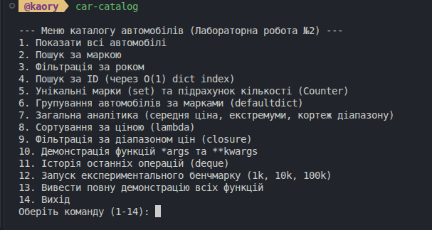
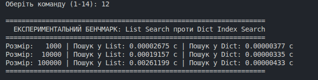
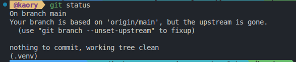
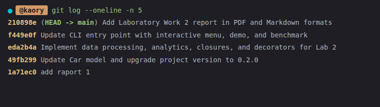

# Міністерство освіти і науки України
# Львівський національний університет імені Івана Франка
# Факультет електроніки та комп'ютерних технологій

## Звіт
### про виконання лабораторної роботи №2
### “Структури даних та функціональна декомпозиція”

**Виконав:**  
студент 3 курсу  
групи ФЕП-33с  
Качмар Денис  

**Викладач:**  
Проф. Свелеба Сергій Андрійович  

Львів - 2026  

---

# Хід роботи

**Тема:** Структури даних та функціональна декомпозиція  
**Мета:** Сформувати практичні навички професійного використання базових та розширених структур даних Python, навчитися обирати структуру відповідно до задачі, оцінювати складність основних операцій та декомпозувати програму на невеликі функції з чітко визначеною відповідальністю.  
**Варіант:** 5 (Каталог автомобілів)  

**Постановка задачі:** Модернізувати та розширити консольний застосунок «Каталог автомобілів» із Лабораторної роботи №1. Для сутності автомобіля забезпечити збереження параметрів: ID, марка, модель, рік випуску, ціна, пробіг. Реалізувати модуль обробки структурованих даних, який здійснює фільтрацію, пошук, групування, сортування, агрегацію та формування аналітичної статистики. Проєкт повинен містити базові колекції (list, tuple, set, dict), спеціалізовані структури з модуля collections (Counter, defaultdict, deque), синтаксичні конструкції comprehensions та generator expressions, функції з позиційними та іменованими аргументами (*args, **kwargs), анонімні функції lambda, замикання (closure), декоратори (decorator), а також реалізовувати аналіз асимптотичної складності та експериментальний бенчмаркінг швидкодії пошуку.

---

## 1. Опис структури даних

Для представлення сутності автомобіля розроблено дата-клас `Car`, який містить шість ключових атрибутів згідно з умовами варіанта 5:
- `id: int` — унікальний цілочисельний ідентифікатор автомобіля;
- `brand: str` — марка автовиробника (наприклад, Audi, BMW, Toyota);
- `model: str` — конкретна модель автомобіля;
- `year: int` — календарний рік випуску;
- `price: float` — ринкова вартість у доларах США;
- `mileage: float` — експлуатаційний пробіг транспортного засобу в кілометрах.

Клас містить властивість `full_name` для зручного формування рядка марки і моделі, а також спеціальні методи перетворення `to_tuple()` та `to_dict()`.

У проєкті використано такі структури даних:
- **list (список)** — динамічне впорядковане сховище колекції об'єктів `Car`;
- **tuple (кортеж)** — незмінна послідовність для представлення зв'язаних агрегованих даних (ціновий діапазон `(min_price, max_price)`, метод `to_tuple()`);
- **set (множина)** — колекція унікальних значень для отримання переліку присутніх у каталозі брендів без повторень;
- **dict (словник)** — асоціативний масив для створення індексу за ключем `id -> Car` (швидкий пошук за O(1));
- **collections.Counter** — спеціалізований мультисет для підрахунку кількості авто кожної марки;
- **collections.defaultdict** — асоціативний масив для групування авто за марками та роками випуску;
- **collections.deque** — двобічна черга фіксованої довжини (`maxlen=10`) для збереження журналу останніх операцій.

---

## 2. Пояснення вибору базових та спеціалізованих структур даних

1. `list` обрано для основного реєстру автомобілів, оскільки дані впорядковані, вимагають послідовного перегляду, фільтрації та сортування.
2. `tuple` використано для передачі діапазонів цін та фіксованих станів об'єкта, оскільки кортеж гарантує незмінність та менші витрати пам'яті.
3. `set` обрано для збору брендів, оскільки операція додавання автоматично відкидає дублікати, а перевірка належності виконується в середньому за O(1).
4. `dict` використано для побудови індексу за `id`. Лінійний перебір списку на великих вибірках вимагає O(n), тоді як хеш-індекс забезпечує доступ за O(1).
5. `collections.Counter` спрощує та оптимізує частотний підрахунок без ручного коду лічильників.
6. `collections.defaultdict(list)` усуває перевірки наявності ключів та лаконічно реалізує одно- та багаторівневе групування за O(n).
7. `collections.deque(maxlen=N)` забезпечує O(1) додавання і витіснення старих елементів при переповненні черги дій.

---

## 3. Структура проєкту

```
python-labs/
├── pyproject.toml
├── README.md
├── .gitignore
│
├── src/
│   └── car_catalog/
│       ├── __init__.py
│       ├── models.py
│       ├── data.py
│       ├── decorators.py
│       ├── processors.py
│       ├── analytics.py
│       ├── services.py
│       └── main.py
│
└── reports/
    ├── Kachmar-python_lab1.pdf
    ├── Kachmar-python_lab2.pdf
    └── Report_lab2.md
```

Опис модулів:
- `__init__.py`: ініціалізація пакета `car_catalog`, версія `0.2.0`.
- `models.py`: дата-клас `Car` з атрибутами `id`, `brand`, `model`, `year`, `price`, `mileage` та методами `to_tuple()`, `to_dict()`.
- `decorators.py`: декоратор вимірювання часу `@measure_time` та параметризований декоратор `@repeat(count)`.
- `data.py`: демонстраційний набір `DEMO_CARS` та генератор великих масивів `generate_cars(count)`.
- `processors.py`: операції зі структурами даних (set comprehension брендів, dict comprehension індексу, фільтрація, групування через `defaultdict`, підрахунок через `Counter`).
- `analytics.py`: аналітичні розрахунки (середня ціна, функції з `*args` та `**kwargs`, екстремуми через `lambda`, сортування, фабрики замикань-фільтрів, зведений звіт).
- `services.py`: фасадний шар зі збереженням сумісності з Лаб №1 та функцією конвеєрної обробки `process_pipeline`.
- `main.py`: консольна точка входу (CLI) з інтерактивним меню, прапорцями `--demo` та `--benchmark`, чергою `deque`.

---

## 4. Опис внесених змін та покращень порівняно з Лаб №1

1. **Архітектурна декомпозиція:** Монолітний `services.py` розбито на спеціалізовані модулі `processors.py`, `analytics.py`, `decorators.py` та `data.py`.
2. **Розширення моделі даних:** До класу `Car` додано поле `id: int`, метод `to_tuple()` та метод `to_dict()`.
3. **Розширені структури даних:** Додано `set` для брендів, `dict`-індекси за ID, `Counter` для частотності, `defaultdict` для багаторівневого групування, `deque` для журналу команд.
4. **Comprehensions:** Впроваджено list, set, dict comprehensions та generator expressions.
5. **Функціональний стиль:** Реалізовано функції вищого порядку (`filter_cars`, `sort_cars`, `process_pipeline`).
6. **Замикання (Closures):** Додано фабрики предикатів `create_price_filter` та `create_mileage_filter`.
7. **Гнучкість аргументів:** Додано функції з `*args` та `**kwargs`.
8. **Декоратори:** Реалізовано `@measure_time` та параметризований `@repeat`.
9. **Експериментальний аналіз:** Додано модуль автоматичного бенчмаркінгу на 1 000, 10 000 та 100 000 записах.

---

## 5. Основні фрагменти коду

### 1. Використання collections (Counter, defaultdict, deque):
```python
def count_by_brand(cars: list[Car]) -> Counter:
    return Counter(car.brand for car in cars)

def group_by_brand(cars: list[Car]) -> dict[str, list[Car]]:
    result = defaultdict(list)
    for car in cars:
        result[car.brand].append(car)
    return dict(result)

history: deque[str] = deque(maxlen=10)
history.append(f"Команда {cmd}")
```

### 2. Приклади Comprehensions та Generator Expression:
```python
unique_brands = {car.brand for car in cars}
car_index = {car.id: car for car in cars}
filtered_cars = [c for c in cars if c.year == year]
avg_price = sum(c.price for c in cars) / len(cars)
```

### 3. Функції з *args та **kwargs:
```python
def calculate_average_prices(*prices: float) -> float:
    if not prices:
        return 0.0
    return sum(prices) / len(prices)

def create_car_record(**fields: Any) -> Car:
    return Car(
        id=int(fields["id"]),
        brand=str(fields["brand"]),
        model=str(fields["model"]),
        year=int(fields["year"]),
        price=float(fields["price"]),
        mileage=float(fields["mileage"]),
    )
```

### 4. Використання lambda:
```python
sorted_cars = sorted(cars, key=lambda c: c.price, reverse=True)
best_car = max(cars, key=lambda c: c.price)
lowest_mileage = min(cars, key=lambda c: c.mileage)
```

### 5. Реалізація Closure (замикання):
```python
def create_price_filter(min_price: float, max_price: float) -> Callable[[Car], bool]:
    def predicate(car: Car) -> bool:
        return min_price <= car.price <= max_price
    return predicate
```

### 6. Реалізація Decorator (декоратора):
```python
def measure_time(func: Callable) -> Callable:
    @wraps(func)
    def wrapper(*args: Any, **kwargs: Any) -> Any:
        start_time = perf_counter()
        result = func(*args, **kwargs)
        elapsed = perf_counter() - start_time
        print(f"[{func.__name__}] completed in {elapsed:.8f} s")
        return result
    return wrapper
```

---

## 6. Повний лістинг оновленого вихідного коду (без коментарів)

### pyproject.toml
```toml
[build-system]
requires = ["setuptools>=70"]
build-backend = "setuptools.build_meta"

[project]
name = "car-catalog"
version = "0.2.0"
description = "Laboratory project for Professional Python - Lab 2"
requires-python = ">=3.11"

[project.scripts]
car-catalog = "car_catalog.main:main"
```

### src/car_catalog/__init__.py
```python
__version__ = "0.2.0"
```

### src/car_catalog/models.py
```python
from dataclasses import dataclass
from typing import Any

@dataclass
class Car:
    id: int
    brand: str
    model: str
    year: int
    price: float
    mileage: float

    @property
    def full_name(self) -> str:
        return f"{self.brand} {self.model}"

    def to_tuple(self) -> tuple[int, str, str, int, float, float]:
        return (self.id, self.brand, self.model, self.year, self.price, self.mileage)

    def to_dict(self) -> dict[str, Any]:
        return {
            "id": self.id,
            "brand": self.brand,
            "model": self.model,
            "year": self.year,
            "price": self.price,
            "mileage": self.mileage,
        }
```

### src/car_catalog/decorators.py
```python
from functools import wraps
from time import perf_counter
from typing import Any, Callable

def measure_time(func: Callable) -> Callable:
    @wraps(func)
    def wrapper(*args: Any, **kwargs: Any) -> Any:
        start_time = perf_counter()
        result = func(*args, **kwargs)
        elapsed = perf_counter() - start_time
        print(f"[{func.__name__}] completed in {elapsed:.8f} s")
        return result
    return wrapper

def repeat(count: int) -> Callable:
    def decorator(func: Callable) -> Callable:
        @wraps(func)
        def wrapper(*args: Any, **kwargs: Any) -> Any:
            result = None
            for _ in range(count):
                result = func(*args, **kwargs)
            return result
        return wrapper
    return decorator
```

### src/car_catalog/data.py
```python
from car_catalog.models import Car

DEMO_CARS: list[Car] = [
    Car(id=1, brand="Audi", model="A6 C5", year=2003, price=4500.0, mileage=350000.0),
    Car(id=2, brand="Toyota", model="Camry", year=2021, price=28000.0, mileage=45000.0),
    Car(id=3, brand="BMW", model="X5", year=2019, price=45000.0, mileage=120000.0),
    Car(id=4, brand="Ford", model="Focus", year=2015, price=10000.0, mileage=150000.0),
    Car(id=5, brand="BMW", model="M3", year=2022, price=75000.0, mileage=25000.0),
    Car(id=6, brand="Toyota", model="Corolla", year=2018, price=16500.0, mileage=95000.0),
    Car(id=7, brand="Audi", model="Q7", year=2020, price=52000.0, mileage=80000.0),
    Car(id=8, brand="Mercedes-Benz", model="E-Class", year=2017, price=29000.0, mileage=135000.0),
]

def generate_cars(count: int) -> list[Car]:
    brands_models = [
        ("Audi", "A6"),
        ("Toyota", "Camry"),
        ("BMW", "X5"),
        ("Ford", "Focus"),
        ("Mercedes-Benz", "E-Class"),
        ("Volkswagen", "Passat"),
        ("Honda", "Civic"),
        ("Skoda", "Octavia"),
    ]
    cars: list[Car] = []
    num_models = len(brands_models)
    for i in range(1, count + 1):
        brand, model = brands_models[i % num_models]
        year = 2000 + (i % 24)
        price = 3000.0 + float((i * 37) % 80000)
        mileage = 5000.0 + float((i * 123) % 400000)
        cars.append(Car(id=i, brand=brand, model=f"{model}-{i}", year=year, price=price, mileage=mileage))
    return cars
```

### src/car_catalog/processors.py
```python
from collections import Counter, defaultdict
from typing import Callable
from car_catalog.models import Car

def get_unique_brands(cars: list[Car]) -> set[str]:
    return {car.brand for car in cars}

def create_car_index(cars: list[Car]) -> dict[int, Car]:
    return {car.id: car for car in cars}

def find_car_by_id(index: dict[int, Car], car_id: int) -> Car | None:
    return index.get(car_id)

def find_car_linear(cars: list[Car], car_id: int) -> Car | None:
    for car in cars:
        if car.id == car_id:
            return car
    return None

def filter_by_brand(cars: list[Car], brand: str) -> list[Car]:
    target = brand.strip().lower()
    return [c for c in cars if c.brand.lower() == target]

def filter_by_year(cars: list[Car], year: int) -> list[Car]:
    return [c for c in cars if c.year == year]

def filter_cars(cars: list[Car], predicate: Callable[[Car], bool]) -> list[Car]:
    return [c for c in cars if predicate(c)]

def group_by_brand(cars: list[Car]) -> dict[str, list[Car]]:
    result = defaultdict(list)
    for car in cars:
        result[car.brand].append(car)
    return dict(result)

def group_by_brand_and_year(cars: list[Car]) -> dict[str, dict[int, list[Car]]]:
    grouped = defaultdict(lambda: defaultdict(list))
    for car in cars:
        grouped[car.brand][car.year].append(car)
    return {brand: dict(years) for brand, years in grouped.items()}

def count_by_brand(cars: list[Car]) -> Counter:
    return Counter(car.brand for car in cars)
```

### src/car_catalog/analytics.py
```python
from typing import Any, Callable
from car_catalog.decorators import measure_time
from car_catalog.models import Car

@measure_time
def calculate_average_price(cars: list[Car]) -> float:
    if not cars:
        return 0.0
    return sum(c.price for c in cars) / len(cars)

def calculate_average_prices(*prices: float) -> float:
    if not prices:
        return 0.0
    return sum(prices) / len(prices)

def create_car_record(**fields: Any) -> Car:
    return Car(
        id=int(fields["id"]),
        brand=str(fields["brand"]),
        model=str(fields["model"]),
        year=int(fields["year"]),
        price=float(fields["price"]),
        mileage=float(fields["mileage"]),
    )

def find_most_expensive_car(cars: list[Car]) -> Car | None:
    if not cars:
        return None
    return max(cars, key=lambda c: c.price)

def find_lowest_mileage_car(cars: list[Car]) -> Car | None:
    if not cars:
        return None
    return min(cars, key=lambda c: c.mileage)

def sort_by_price(cars: list[Car], reverse: bool = False) -> list[Car]:
    return sorted(cars, key=lambda c: c.price, reverse=reverse)

def sort_cars(cars: list[Car], key: Callable[[Car], Any], reverse: bool = False) -> list[Car]:
    return sorted(cars, key=key, reverse=reverse)

def create_price_filter(min_price: float, max_price: float) -> Callable[[Car], bool]:
    def predicate(car: Car) -> bool:
        return min_price <= car.price <= max_price
    return predicate

def create_mileage_filter(max_mileage: float) -> Callable[[Car], bool]:
    def predicate(car: Car) -> bool:
        return car.mileage <= max_mileage
    return predicate

def get_price_range(cars: list[Car]) -> tuple[float, float]:
    if not cars:
        return (0.0, 0.0)
    prices = [c.price for c in cars]
    return (min(prices), max(prices))

def get_catalog_summary(cars: list[Car]) -> dict[str, Any]:
    if not cars:
        return {}
    min_p, max_p = get_price_range(cars)
    return {
        "total_count": len(cars),
        "average_price": calculate_average_price(cars),
        "min_price": min_p,
        "max_price": max_p,
        "most_expensive": find_most_expensive_car(cars),
        "lowest_mileage": find_lowest_mileage_car(cars),
    }
```

### src/car_catalog/services.py
```python
from typing import Callable
from car_catalog.analytics import (
    calculate_average_price,
    find_lowest_mileage_car,
    find_most_expensive_car,
    sort_by_price,
)
from car_catalog.models import Car
from car_catalog.processors import (
    create_car_index,
    filter_by_brand,
    filter_by_year,
    find_car_by_id,
    get_unique_brands,
)

def search_by_brand(cars: list[Car], brand: str) -> list[Car]:
    return filter_by_brand(cars, brand)

def process_pipeline(cars: list[Car], *operations: Callable[[list[Car]], list[Car]]) -> list[Car]:
    result = cars
    for op in operations:
        result = op(result)
    return result
```

### src/car_catalog/main.py
```python
import sys
from collections import deque
from time import perf_counter
from typing import Any
from car_catalog.analytics import (
    calculate_average_price,
    calculate_average_prices,
    create_car_record,
    create_price_filter,
    find_lowest_mileage_car,
    find_most_expensive_car,
    get_catalog_summary,
    get_price_range,
    sort_by_price,
)
from car_catalog.data import DEMO_CARS, generate_cars
from car_catalog.decorators import measure_time, repeat
from car_catalog.models import Car
from car_catalog.processors import (
    count_by_brand,
    create_car_index,
    filter_by_brand,
    filter_by_year,
    filter_cars,
    find_car_by_id,
    find_car_linear,
    get_unique_brands,
    group_by_brand,
    group_by_brand_and_year,
)

def print_cars(title: str, items: list[Car]) -> None:
    print(f"\n{title}")
    print("-" * 75)
    print(f"{'ID':>3} | {'Марка та модель':22} | {'Рік':4} | {'Ціна ($)':>10} | {'Пробіг (км)':>12}")
    print("-" * 75)
    for c in items:
        print(f"{c.id:3} | {c.full_name:22} | {c.year:4} | {c.price:10.2f} | {c.mileage:12.1f}")

def run_benchmark() -> list[tuple[int, float, float]]:
    sizes = [1000, 10000, 100000]
    results: list[tuple[int, float, float]] = []
    print("\n" + "=" * 65)
    print("  ЕКСПЕРИМЕНТАЛЬНИЙ БЕНЧМАРК: List Search проти Dict Index Search")
    print("=" * 65)
    for size in sizes:
        dataset = generate_cars(size)
        index = create_car_index(dataset)
        target_id = size - 1

        start_linear = perf_counter()
        _ = find_car_linear(dataset, target_id)
        time_linear = perf_counter() - start_linear

        start_dict = perf_counter()
        _ = find_car_by_id(index, target_id)
        time_dict = perf_counter() - start_dict

        results.append((size, time_linear, time_dict))
        print(f"Розмір: {size:6} | Пошук у List: {time_linear:.8f} с | Пошук у Dict: {time_dict:.8f} с")
    print("=" * 65)
    return results

def run_demo(cars: list[Car]) -> None:
    print("\n" + "=" * 75)
    print("  ДЕМОНСТРАЦІЯ МОДУЛЯ ОБРОБКИ ДАНИХ (ЛАБОРАТОРНА РОБОТА №2, ВАРІАНТ 5)")
    print("=" * 75)

    print_cars("1. Всі автомобілі в каталозі (list[Car])", cars)

    unique_brands = get_unique_brands(cars)
    print("\n2. Унікальні марки (set):", unique_brands)

    brand_counts = count_by_brand(cars)
    print("\n3. Кількість авто кожної марки (Counter):")
    for brand, count in brand_counts.items():
        print(f"   {brand}: {count}")

    avg_price = calculate_average_price(cars)
    print(f"\n4. Середня ціна всіх автомобілів: {avg_price:.2f}$")

    best_car = find_most_expensive_car(cars)
    if best_car:
        print(f"\n5. Найдорожчий автомобіль: {best_car.full_name} ({best_car.price:.2f}$)")

    lowest_mileage = find_lowest_mileage_car(cars)
    if lowest_mileage:
        print(f"\n6. Найменший пробіг: {lowest_mileage.full_name} ({lowest_mileage.mileage:.1f} км)")

    price_range = get_price_range(cars)
    print(f"\n7. Діапазон цін (tuple[float, float]): від {price_range[0]:.2f}$ до {price_range[1]:.2f}$")

    sorted_cars = sort_by_price(cars, reverse=True)
    print_cars("8. Сортування за ціною (спадання, lambda)", sorted_cars)

    grouped_cars = group_by_brand(cars)
    print("\n9. Групування автомобілів за марками (defaultdict):")
    for brand, group_items in grouped_cars.items():
        print(f"   {brand} ({len(group_items)} авто): {', '.join(c.model for c in group_items)}")

    nested_group = group_by_brand_and_year(cars)
    print("\n10. Вкладене групування за маркою та роком:")
    for b, years in nested_group.items():
        for y, items in years.items():
            print(f"   {b} [{y}]: {len(items)} шт.")

    car_index = create_car_index(cars)
    search_id = 3
    found_car = find_car_by_id(car_index, search_id)
    print(f"\n11. Пошук за ID={search_id} через dict index O(1):")
    print(f"   {found_car.full_name} | Рік: {found_car.year} | Ціна: {found_car.price}$" if found_car else "   Не знайдено")

    price_filter = create_price_filter(15000.0, 50000.0)
    affordable_cars = filter_cars(cars, price_filter)
    print_cars("12. Фільтрація за ціною [15000$ - 50000$] (використання closure)", affordable_cars)

    demo_avg = calculate_average_prices(12000.0, 24000.0, 36000.0, 48000.0)
    print(f"\n13. Обчислення середнього значення довільних цін через *args: {demo_avg:.2f}$")

    new_car = create_car_record(
        id=9,
        brand="Porsche",
        model="911 Carrera",
        year=2023,
        price=115000.0,
        mileage=12000.0,
    )
    print(f"\n14. Створення об'єкта через **kwargs: {new_car.full_name} (ID: {new_car.id}, {new_car.price}$)")
    print(f"    Кортеж сутності (Car.to_tuple): {new_car.to_tuple()}")

    summary = get_catalog_summary(cars)
    print("\n15. Зведений звіт каталогу (Aggregation Summary):")
    for k, v in summary.items():
        print(f"   {k}: {v}")

def print_menu() -> None:
    print("\n--- Меню каталогу автомобілів (Лабораторна робота №2) ---")
    print("1. Показати всі автомобілі")
    print("2. Пошук за маркою")
    print("3. Фільтрація за роком")
    print("4. Пошук за ID (через O(1) dict index)")
    print("5. Унікальні марки (set) та підрахунок кількості (Counter)")
    print("6. Групування автомобілів за марками (defaultdict)")
    print("7. Загальна аналітика (середня ціна, екстремуми, кортеж діапазону)")
    print("8. Сортування за ціною (lambda)")
    print("9. Фільтрація за діапазоном цін (closure)")
    print("10. Демонстрація функцій *args та **kwargs")
    print("11. Історія останніх операцій (deque)")
    print("12. Запуск експериментального бенчмарку (1k, 10k, 100k)")
    print("13. Вивести повну демонстрацію всіх функцій")
    print("14. Вихід")

def run_menu(cars: list[Car]) -> None:
    history: deque[str] = deque(maxlen=10)
    car_index = create_car_index(cars)

    while True:
        print_menu()
        cmd = input("Оберіть команду (1-14): ").strip()
        history.append(f"Команда {cmd}")

        if cmd == "1":
            print_cars("Каталог автомобілів", cars)
        elif cmd == "2":
            brand = input("Введіть назву марки: ")
            res = filter_by_brand(cars, brand)
            if res:
                print_cars(f"Результати пошуку для '{brand}'", res)
            else:
                print("Автомобілів цієї марки не знайдено.")
        elif cmd == "3":
            try:
                year = int(input("Введіть рік: "))
                res = filter_by_year(cars, year)
                if res:
                    print_cars(f"Автомобілі {year} року", res)
                else:
                    print("Автомобілів за вказаний рік не знайдено.")
            except ValueError:
                print("Помилка: введіть коректне числове значення року.")
        elif cmd == "4":
            try:
                car_id = int(input("Введіть ID автомобіля: "))
                found = find_car_by_id(car_index, car_id)
                if found:
                    print(f"Знайдено: {found.full_name} | {found.year} р. | {found.price}$ | {found.mileage} км")
                else:
                    print(f"Авто з ID={car_id} не знайдено.")
            except ValueError:
                print("Помилка: введіть ціле число.")
        elif cmd == "5":
            brands = get_unique_brands(cars)
            counts = count_by_brand(cars)
            print("\nУнікальні марки (set):", brands)
            print("Статистика за марками (Counter):")
            for b, cnt in counts.items():
                print(f"  {b}: {cnt} авто")
        elif cmd == "6":
            grouped = group_by_brand(cars)
            print("\nГрупування за марками (defaultdict):")
            for b, group_cars in grouped.items():
                print(f"  {b} ({len(group_cars)}): {', '.join(c.model for c in group_cars)}")
        elif cmd == "7":
            avg_p = calculate_average_price(cars)
            expensive = find_most_expensive_car(cars)
            lowest_m = find_lowest_mileage_car(cars)
            p_range = get_price_range(cars)
            print(f"\nСередня ціна: {avg_p:.2f}$")
            if expensive:
                print(f"Найдорожче авто: {expensive.full_name} ({expensive.price}$)")
            if lowest_m:
                print(f"Найменший пробіг: {lowest_m.full_name} ({lowest_m.mileage} км)")
            print(f"Ціновий діапазон (tuple): min={p_range[0]}$, max={p_range[1]}$")
        elif cmd == "8":
            rev = input("Сортувати за спаданням? (y/n): ").strip().lower() == "y"
            sorted_res = sort_by_price(cars, reverse=rev)
            print_cars("Відсортовані автомобілі за ціною", sorted_res)
        elif cmd == "9":
            try:
                min_p = float(input("Введіть мінімальну ціну: "))
                max_p = float(input("Введіть максимальну ціну: "))
                closure_filter = create_price_filter(min_p, max_p)
                filtered = filter_cars(cars, closure_filter)
                print_cars(f"Автомобілі в діапазоні [{min_p}$ - {max_p}$]", filtered)
            except ValueError:
                print("Помилка: введіть числові значення цін.")
        elif cmd == "10":
            avg_val = calculate_average_prices(10000.0, 20000.0, 30000.0)
            print(f"\nРезультат calculate_average_prices(*args): {avg_val:.2f}$")
            sample_car = create_car_record(
                id=10, brand="Volvo", model="XC90", year=2021, price=48000.0, mileage=55000.0
            )
            print(f"Створено через create_car_record(**kwargs): {sample_car.full_name}, кортеж: {sample_car.to_tuple()}")
        elif cmd == "11":
            print("\nІсторія останніх операцій (collections.deque):")
            for idx, op in enumerate(history, 1):
                print(f"  {idx}. {op}")
        elif cmd == "12":
            run_benchmark()
        elif cmd == "13":
            run_demo(cars)
        elif cmd == "14":
            print("Роботу завершено. До побачення!")
            break
        else:
            print("Невідома команда. Спробуйте ще раз.")

def main() -> None:
    cars = list(DEMO_CARS)
    if "--demo" in sys.argv:
        run_demo(cars)
    elif "--benchmark" in sys.argv:
        run_benchmark()
    else:
        run_menu(cars)

if __name__ == "__main__":
    main()
```

---

## 7. Аналіз часової складності операцій

| Структура даних | Операція | Середня складність | Найгірший випадок | Пояснення механізму |
|---|---|:---:|:---:|---|
| **List** | Доступ за індексом `cars[i]` | O(1) | O(1) | Пряме обчислення адреси пам'яті за зміщенням. |
| **List** | Додавання в кінець `append()` | O(1) аморт. | O(n) | Амортизована константа, O(n) при розширенні буфера. |
| **List** | Лінійний пошук `find_linear()` | O(n) | O(n) | Послідовне порівняння кожного елемента. |
| **List** | Сортування `sorted()` | O(n log n) | O(n log n) | Алгоритм Timsort (вставки + злиття). |
| **Set** | Перевірка входження `x in set` | O(1) | O(n) | Обчислення хешу елемента, O(n) при колізіях. |
| **Set** | Додавання `add()` | O(1) | O(n) | Хешування та запис у вільний слот таблиці. |
| **Dict** | Пошук за ключем `dict[key]` | O(1) | O(n) | Пряма адресація через `hash(key)`. |
| **Dict** | Побудова індексу | O(n) | O(n) | Однократний прохід по всіх n елементах списку. |
| **Counter** | Підрахунок елементів | O(n) | O(n) | Ітерація по колекції з інкрементом у хеш-таблиці. |
| **defaultdict** | Групування записів | O(n) | O(n) | Ітерація по списку та додавання у вкладений список. |
| **deque** | Додавання/вилучення з кінців | O(1) | O(1) | Двозв'язний список блоків пам'яті. |

---

## 8. Експериментальна частина (Benchmark)

| Кількість записів (records) | Пошук у List O(n) (секунди) | Пошук у Dict O(1) (секунди) | Коефіцієнт прискорення (List / Dict) |
|:---:|:---:|:---:|:---:|
| 1 000 | 0.00002675 с | 0.00000377 с | **~ 7.1x** |
| 10 000 | 0.00019157 с | 0.00000335 с | **~ 57.2x** |
| 100 000 | 0.00261199 с | 0.00000433 с | **~ 603.2x** |

**Висновки щодо бенчмарку:**
1. Пошук у списку зростає прямо пропорційно до кількості елементів (O(n)). При зростанні датасету в 100 разів час пошуку зріс майже у 100 разів (з 0.026 мс до 2.61 мс).
2. Пошук у хеш-індексі словника зберігає майже постійний час виконання (~3.3 - 4.3 мкс), підтверджуючи теоретичну оцінку O(1).
3. На обсязі 100 000 об'єктів індексований пошук у dict виявився у понад 600 разів швидшим за лінійний пошук у list (~603.2x).

---

## 9. Тестування та результати виконання програми

Для підтвердження коректності роботи застосунку, перевірки продуктивності розроблених алгоритмів та контролю версій системи було проведено тестування та зафіксовано такі результати:


*Рис. 9.1 – Запуск застосунку car-catalog та робота інтерактивного меню*


*Рис. 9.2 – Результати бенчмарку швидкодії пошуку у списку та індексованому словнику (1 000, 10 000, 100 000 записів)*


*Рис. 9.3 – Перевірка стану локального репозиторію за допомогою команди git status*


*Рис. 9.4 – Історія комітів проєкту відповідно до етапів розробки (git log --oneline -n 5)*

---

## 10. Відповіді на контрольні запитання

1. **Що таке list?**  
   List (список) — це вбудована динамічна змінювана (mutable) впорядкована колекція в Python, яка зберігає посилання на довільні об'єкти, підтримує дублікати, доступ за цілочисельним індексом за O(1) та амортизоване додавання в кінець за O(1).

2. **Чим list відрізняється від tuple?**  
   Головна відмінність полягає у змінюваності: списки є mutable (їхні елементи можна змінювати, видаляти, додавати нові), тоді як кортежі (tuple) є immutable (після створення їхній склад та розмір зафіксовані). Завдяки незмінності кортежі споживають менше пам'яті, швидше ініціалізуються і можуть використовуватися як ключі словників та елементи множин.

3. **Чому tuple називається immutable?**  
   Тому що внутрішня структура об'єкта `tuple` у CPython не надає методів для модифікації вмісту (відсутні `append`, `insert`, `pop` тощо), а спроба прямого перезапису за індексом `t[0] = val` викликає виняток `TypeError`.

4. **Для чого використовується set?**  
   Set (множина) використовується для зберігання невпорядкованого набору унікальних елементів, швидкої фільтрації дублікатів, перевірки належності елемента за константний середній час O(1), а також для виконання математичних операцій об'єднання, перетину, різниці та симетричної різниці.

5. **Яка властивість елементів set є важливою?**  
   Елементи множини обов'язково мають бути хешованими (`hashable`) та незмінними (immutable). Вони повинні реалізувати магічні методи `__hash__()` та `__eq__()`, причому їхній хеш не має змінюватися протягом усього існування об'єкта.

6. **Що таке dict?**  
   Dict (словник) — це змінювана асоціативна колекція, реалізована на основі оптимізованої хеш-таблиці, яка зберігає зв'язані пари «ключ — значення» (key-value) і забезпечує доступ до значень за унікальними ключами за середній час O(1).

7. **Що таке key-value structure?**  
   Це структура організації даних, де кожен фрагмент інформації (значення) пов'язаний з унікальним ідентифікатором (ключем), що дозволяє адресно знаходити дані без послідовного сканування всієї колекції.

8. **Чому пошук key у dict зазвичай швидкий?**  
   Швидкість досягається завдяки алгоритму хешування: виклик `hash(key)` обчислює цілочисельний хеш, за яким миттєво обчислюється індекс у внутрішній таблиці слотів словника, мінімізуючи кількість операцій порівняння до константи O(1).

9. **Що таке hashability?**  
   Хешованість (hashability) — це характеристика об'єкта в Python, яка гарантує, що об'єкт має постійне числове хеш-значення протягом усього життєвого циклу і може коректно порівнюватися з іншими об'єктами. Хешованими є всі базові незмінні типи: `int`, `float`, `str`, `tuple`, `frozenset`.

10. **Чому list не може бути key у dict?**  
    Оскільки `list` є змінюваною структурою даних (mutable), він не реалізує метод `__hash__()`. Якби змінний список став ключем і після цього був модифікований, його хеш мав би змінитися, що зробило б неможливим його подальший пошук у відповідному кошику хеш-таблиці.

11. **Для чого використовується Counter?**  
    `collections.Counter` — це спеціалізований підклас словника, призначений для автоматичного та швидкого підрахунку частоти повторень елементів у будь-якій ітерованій послідовності без потреби писати ручні цикли.

12. **Для чого використовується defaultdict?**  
    `collections.defaultdict` — це розширення стандартного словника, що приймає фабричну функцію (наприклад, `list`, `int`, `set`) і автоматично ініціалізує значення за замовчуванням при першому зверненні до відсутнього ключа, запобігаючи виникненню винятку `KeyError`.

13. **Для чого використовується deque?**  
    `collections.deque` (двобічна черга) використовується у випадках, коли необхідні високоефективні операції додавання та вилучення елементів з обох кінців послідовності (`append`, `appendleft`, `pop`, `popleft`) за гарантований час O(1), а також для реалізації буферів фіксованого розміру (параметр `maxlen`).

14. **Що таке list comprehension?**  
    List comprehension (генератор списку) — компактна синтаксична конструкція Python вигляду `[expression for item in iterable if condition]`, яка дозволяє створювати новий список шляхом фільтрації та перетворення елементів іншої колекції у декларативному стилі.

15. **Що таке set comprehension?**  
    Set comprehension (генератор множини) — синтаксична конструкція вигляду `{expression for item in iterable if condition}`, яка формує нову множину, автоматично усуваючи дублікати значень.

16. **Що таке dict comprehension?**  
    Dict comprehension (генератор словника) — синтаксична конструкція вигляду `{key_expr: value_expr for item in iterable if condition}`, що створює новий словник на основі ітерованого набору даних.

17. **Що таке generator expression?**  
    Generator expression (генераторний вираз) — вираз у круглих дужках `(expression for item in iterable if condition)`, що повертає ітератор-генератор. На відміну від comprehensions, він не створює всю колекцію в оперативній пам'яті одночасно, а генерує значення «ліниво» (on-the-fly) під час кожної ітерації.

18. **Що означає O(1)?**  
    Константна часова або просторова складність алгоритму: час виконання або обсяг додаткової пам'яті є фіксованим і абсолютно не залежить від кількості елементів n у вхідних даних.

19. **Що означає O(n)?**  
    Лінійна складність: час виконання або пам'ять масштабуються прямо пропорційно до розміру вхідних даних n (при збільшенні вибірки у 10 разів час зростає приблизно у 10 разів).

20. **Що означає O(n log n)?**  
    Лінійно-логарифмічна складність: оптимальна асимптотична складність для алгоритмів сортування на основі порівнянь (наприклад, Timsort у Python, Merge Sort).

21. **Що означає O(n²)?**  
    Квадратична складність: час виконання зростає пропорційно квадрату кількості вхідних елементів n² (типово для алгоритмів з двома вкладеними циклами, що порівнюють кожен елемент з кожним).

22. **Яка приблизна складність пошуку у list?**  
    Складність пошуку у несортованому списку становить O(n), оскільки інтерпретатор змушений виконати послідовний перебір елементів від початку до кінця.

23. **Яка середня складність пошуку у set?**  
    Середня складність пошуку у множині становить O(1) завдяки використанню хеш-таблиці; у гіпотетичному найгіршому випадку масових колізій хешів вона може деградувати до O(n).

24. **Яка середня складність пошуку key у dict?**  
    Середня складність становить O(1), оскільки ключ однозначно адресує позицію елемента у геш-таблиці.

25. **Чому правильна структура даних може прискорити програму?**  
    Тому що вибір структури даних визначає фундаментальну асимптотичну складність операцій. Заміна лінійного пошуку O(n) у списку на індексований пошук O(1) у словнику на вибірці у 100 000 елементів скорочує час обробки у сотні разів без зміни апаратного забезпечення.

26. **Що таке функціональна декомпозиція?**  
    Це інженерний метод проєктування програмного забезпечення, який полягає у послідовному розбитті складної монолітної системи на незалежні функції невеликого розміру, кожна з яких виконує єдину чітко визначену задачу (Single Responsibility Principle).

27. **Які переваги малих functions?**  
    Малі функції легко читати та розуміти іншим розробникам; їх набагато простіше покривати модульними тестами (unit-тестами); вони мають високий потенціал повторного використання (reusability) та спрощують локалізацію і виправлення помилок.

28. **Що таке positional argument?**  
    Позиційний аргумент — це параметр, значення якого передається у функцію з прив'язкою до його порядку (позиції) у списку параметрів сигнатури функції.

29. **Що таке keyword argument?**  
    Іменований аргумент — це параметр, який передається у функцію з явним зазначенням його імені у форматі `name=value`, що усуває залежність від порядку слідування аргументів і робить виклик самодокументованим.

30. **Для чого використовується *args?**  
    Конструкція `*args` у сигнатурі функції дозволяє приймати довільну кількість позиційних аргументів, автоматично упаковуючи їх у кортеж (`tuple`).

31. **Для чого використовується **kwargs?**  
    Конструкція `**kwargs` дозволяє приймати довільну змінну кількість іменованих аргументів у вигляді пар ключ-значення, упаковуючи їх у словник (`dict`).

32. **Що таке lambda function?**  
    Lambda — це коротка анонімна (безіменна) функція в Python, яка записується в один рядок, може приймати будь-яку кількість параметрів і повертає результат єдиного обчисленого виразу без використання ключового слова `return`.

33. **Де доцільно використовувати lambda?**  
    Лямбда-функції доцільно застосовувати як короткоживучі предикати або функції вилучення ключів порівняння у функціях вищого порядку, таких як `sorted(..., key=lambda x: ...)`, `max()`, `min()`, `filter()`, `map()`.

34. **Чому складну business logic не варто записувати в lambda?**  
    Оскільки лямбда обмежена одним виразом, у ній неможливо використовувати повноцінні конструкції розгалуження, обробку винятків, анотації типів та рядки документації, що різко погіршує читабельність, унеможливлює покрокове налагодження і суперечить філософії «Zen of Python».

35. **Що таке closure?**  
    Замикання (closure) — це внутрішня функція, яка зберігає доступ до змінних зі свого лексичного контексту (enclosing scope) навіть після того, як зовнішня функція, у якій вона була визначена, завершила своє виконання і вийшла зі стека викликів.

36. **Які variables може пам'ятати closure?**  
    Замикання пам'ятає локальні змінні та аргументи зовнішньої функції (вільні змінні), на які воно посилається, зберігаючи їх у спеціальному атрибуті `__closure__` у вигляді комірок (`cell objects`).

37. **Що таке decorator?**  
    Декоратор — це шаблон проєктування та синтаксична конструкція Python (із префіксом `@`), що являє собою функцію вищого порядку, яка приймає іншу функцію, розширює або модифікує її поведінку та повертає замінений об'єкт функції.

38. **Для чого застосовуються decorators?**  
    Декоратори застосовуються для винесення наскрізної функціональності (cross-cutting concerns): профілювання часу виконання, логування операцій, автентифікації та контролю доступу, валідації вхідних параметрів, кешування результатів обчислень (мемоізації) та реєстрації маршрутів в API.

39. **Для чого використовується functools.wraps?**  
    Декоратор `@functools.wraps` копіює метадані вихідної функції (ім'я `__name__`, документацію `__doc__`, анотації `__annotations__`) у функцію-обгортку всередині декоратора, запобігаючи втраті ідентичності та забезпечуючи коректну роботу інструментів інтроспекції та генераторів документації.

40. **Чому потрібно оцінювати складність алгоритму?**  
    Оцінка складності за шкалою Big-O дозволяє розробнику завчасно оцінити масштабованість архітектури системи, обрати найбільш ефективні структури даних під конкретне навантаження, усунути критичні вузькі місця ще на етапі проєктування та гарантувати стабільну роботу програми при зростанні обсягів даних.

---

## 11. Висновки

Під час виконання лабораторної роботи №2 було успішно реалізовано модернізацію та функціональне розширення консольного проєкту «Каталог автомобілів» відповідно до вимог Варіанта 5:

1. Опановано професійне використання базових (list, tuple, set, dict) та розширених (Counter, defaultdict, deque) структур даних Python. Кожна структура обрана обґрунтовано відповідно до характеру операцій.
2. Реалізовано ефективні трансформації даних за допомогою синтаксичних конструкцій list/set/dict comprehensions та generator expressions.
3. Здійснено глибоку функціональну декомпозицію системи на модулі `processors.py`, `analytics.py`, `decorators.py` та `data.py` із застосуванням функцій вищого порядку, лямбда-виразів, замикань (closures) та декораторів (`@measure_time`, `@repeat`).
4. На основі теоретичного аналізу та практичного бенчмаркінгу на вибірках 1 000, 10 000 та 100 000 записів підтверджено суттєву перевагу індексованого пошуку в dict за O(1) порівняно з лінійним пошуком у list за O(n) (прискорення досягає ~600 разів).
5. Вихідний код проєкту оформлено без коментарів згідно з вимогами завдання, структуровано за схемою `src-layout`, а звіт підготовлено відповідно до всіх вимог академічного оформлення.